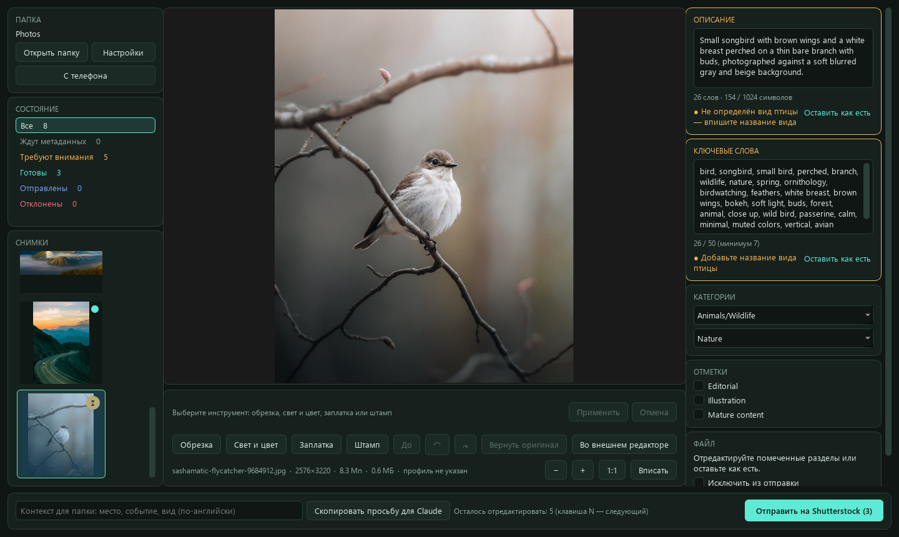

# Stock Uploader

[Русский](README.md) · [English](README.en.md) · **Deutsch**

Ein Windows-Programm, das Fotos für den Verkauf bei Shutterstock vorbereitet: Es prüft die Dateien, zeigt Beschreibungen und Schlagwörter zum Bearbeiten, erlaubt kleine Bildkorrekturen und lädt alles zur Agentur hoch.

## Über das Programm

- **Dateiprüfung.** Sortiert Fotos aus, die die Agentur nicht annimmt: unter 4 MP, über 150 MP, größer als 50 MB, kein JPEG.
- **Beschreibungen und Schlagwörter.** Claude Code schreibt sie im Rahmen Ihres Abonnements in eine Datei neben den Fotos; das Programm übernimmt sie automatisch. Eine kostenpflichtige API ist nicht nötig.
- **Markierungen für die manuelle Bearbeitung.** Abschnitte, die Ihr Wissen brauchen (Tierart, Aufnahmeort, Personen und Logos im Bild), erhalten einen orangen Rahmen mit einem Hinweis, was zu tun ist.
- **Editor.** Zuschnitt und Horizont, Licht und Farbe, Reparatur und Stempel zum Entfernen von Logos und Flecken. Die Originale bleiben unverändert.
- **Fotos vom Handy empfangen** über WLAN per QR-Code, ohne App auf dem Handy.
- **Upload.** FTPS-Upload, der nach einem Verbindungsabbruch fortgesetzt wird, und eine fertige CSV-Datei für die Submit-Seite.
- **Oberfläche** auf Russisch, Englisch und Deutsch, dunkles und helles Design.

**Idee:** M. Mashura
**Technische Umsetzung:** Claude (Anthropic)

## Installation

1. Laden Sie `StockUploader-0.1.0-win64.zip` von der Seite [Releases](../../releases/latest) herunter.
2. Entpacken Sie das Archiv in einen beliebigen Ordner.
3. Starten Sie `StockUploader.exe`.

Es muss nichts installiert werden, Python ist nicht nötig. Das Programm ist nicht signiert; beim ersten
Start kann Windows eine SmartScreen-Warnung zeigen — klicken Sie auf „Weitere Informationen“ → „Trotzdem ausführen“.

Für die Beschreibungen öffnen Sie Claude Code im entpackten Ordner: dort liegt `CLAUDE.md` mit dem Ablauf.

## Kurzanleitung

1. **Ordner öffnen** mit Fotos (JPEG). Zu kleine oder zu große Dateien landen unter „Abgelehnt“.
2. **Fotos vom Handy.** Klicken Sie auf „Vom Handy“, richten Sie die Handykamera auf den QR-Code und wählen Sie die Fotos auf der geöffneten Seite. Handy und Computer müssen im selben WLAN sein; beim ersten Mal fragt Windows nach dem Netzwerkzugriff — erlauben Sie ihn. Die Fotos werden unter `Bilder\StockUploader\Phone` in einem Unterordner mit dem heutigen Datum gespeichert, und das Programm öffnet ihn sofort. Einen anderen Ordner können Sie in den Einstellungen wählen.
3. **Fotos korrigieren**, falls nötig: Zuschnitt und Horizont, Licht und Farbe, Reparatur und Stempel. Jedes Werkzeug hat „Anwenden“ und „Abbrechen“.
4. **Kontext eintragen** unten links — Ort, Ereignis, Artname (auf Englisch). Das lässt sich dem Bild nicht entnehmen.
5. **Beschreibungen holen.** Auf „Anfrage für Claude kopieren“ klicken, in Claude Code einfügen, das im Programmordner geöffnet ist, und senden. Die Fotos wechseln von selbst zu „Bereit“ oder „Brauchen Aufmerksamkeit“.
6. **Markierte durchgehen.** Ein Abschnitt mit orangem Rahmen muss bearbeitet werden, oder Sie klicken auf „So lassen“. Taste **N** — nächstes markiertes Foto.
7. **Hochladen.** „Zu Shutterstock hochladen“ sendet die fertigen Fotos und erstellt eine CSV-Datei.
8. **Auf der Website abschließen.** Auf der Submit-Seite CSV anklicken, die erstellte Datei wählen, die Fotos markieren und auf Submit klicken.

Login und Passwort für Shutterstock werden einmal in den Einstellungen eingegeben; das Passwort liegt in der Windows-Anmeldeinformationsverwaltung. Alle Änderungen werden automatisch gespeichert.

## Wo was liegt

| Was | Wo |
|---|---|
| Bearbeitete Versionen der Fotos | Unterordner `_edited` im Fotoordner |
| Kopien für den Upload und die CSV-Datei | Unterordner `_shutterstock` |
| Beschreibungen von Claude | Datei `_metadata.jsonl` |
| Fotos vom Handy | `Bilder\StockUploader\Phone\JJJJ-MM-TT` |
| Einstellungen | `%APPDATA%\StockUploader\config.json` |
| Ihre Änderungen, Protokoll | `%LOCALAPPDATA%\StockUploader` |
| Kategorienliste und gesperrte Wörter | `categories.txt`, `blocklist.txt` neben dem Programm |

## Einschränkungen

- Nur JPEG; Video, Vektor, RAW und HEIC werden nicht unterstützt.
- Der letzte Schritt — CSV hochladen und Submit klicken — geschieht von Hand auf der Website: Shutterstock bietet dafür keine Programmschnittstelle.
- Die Beschreibungen entstehen in Claude Code auf dem Computer; das Programm selbst ruft kein Modell auf.
- ExifTool ist nicht enthalten. Ohne ExifTool gelangen Beschreibungen und Schlagwörter über die CSV-Datei zur Agentur, was genügt; das Schreiben in die Dateien selbst wird aktiv, wenn `exiftool.exe` neben dem Programm liegt.

## Dokumentation und Bedingungen

- [Benutzerhandbuch](docs/USER_GUIDE.md) (auf Russisch)
- [Änderungsverlauf](CHANGELOG.md) (auf Russisch)
- [Nutzungsbedingungen](LICENSE.txt)

Das Programm ist kostenlos. Der Quelltext wird nicht veröffentlicht.
