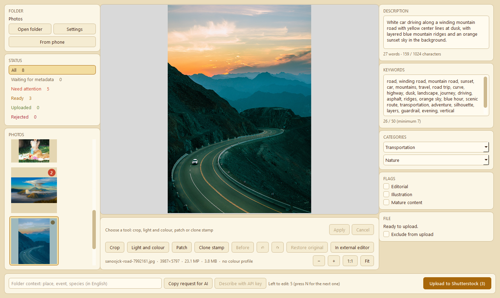

# Stock Uploader

[Русский](README.md) · **English** · [Deutsch](README.de.md)

A Windows program that prepares photos for sale on Shutterstock: it checks the files, shows descriptions and keywords for editing, lets you touch up a photo and uploads everything to the stock site.

## About

- **File check.** Filters out photos the stock site will not accept: under 4 MP, over 150 MP, heavier than 50 MB, not JPEG.
- **Descriptions and keywords.** Claude Code writes them under your subscription into a file next to the photos; the program picks them up automatically. No paid API is needed.
- **Marks for manual editing.** Sections that need your knowledge (animal species, shooting location, people and logos in the frame) get an orange frame with a hint on what to do.
- **Editor.** Crop and horizon straightening, light and colour, patch and clone stamp for removing logos and spots. The originals are never changed.
- **Receiving photos from a phone** over Wi-Fi through a QR code, with no app on the phone.
- **Upload.** FTPS upload that resumes after a dropped connection, and a ready CSV for the Submit page.
- **Interface** in Russian, English and German, with dark and light themes.

**Idea:** M. Mashura
**Technical implementation:** Claude (Anthropic)

## Installation

1. Download `StockUploader-0.1.0-win64.zip` from the [Releases](../../releases/latest) page.
2. Unpack it into any folder.
3. Run `StockUploader.exe`.

Nothing needs to be installed and Python is not required. The program is not signed, so on first start
Windows may show a SmartScreen warning — click “More info” → “Run anyway”.

To get descriptions, open Claude Code in the unpacked folder: it contains `CLAUDE.md` with the workflow.

## Quick guide

1. **Open a folder** with photos (JPEG). Files that are too small or too heavy go to “Rejected”.
2. **Photos from a phone.** Click “From phone”, point the phone camera at the QR code and choose photos on the page that opens. The phone and the computer must be on the same Wi-Fi network; on first use Windows asks for network access — allow it. The photos are saved to `Pictures\StockUploader\Phone`, in a subfolder named by today's date, and the program opens it right away. You can choose another folder in Settings.
3. **Touch up the photos** if needed: crop and horizon, light and colour, patch and clone stamp. Every tool has “Apply” and “Cancel”.
4. **Type the context** at the bottom left — place, event, species name (in English). This cannot be known from the picture.
5. **Get the descriptions.** Click “Copy request for Claude”, paste it into Claude Code opened in the program's folder, and send. The photos move to “Ready” or “Need attention” on their own.
6. **Go through the marked ones.** A section with an orange frame needs editing, or click “Keep as is”. Press **N** for the next marked photo.
7. **Upload.** “Upload to Shutterstock” sends the ready photos and creates a CSV file.
8. **Finish on the website.** On the Submit page click CSV, choose the created file, select the photos and click Submit.

The Shutterstock login and password are entered once in Settings; the password is kept in Windows Credential Manager. All edits are saved automatically.

## Where things are

| What | Where |
|---|---|
| Edited versions of photos | `_edited` subfolder in the photo folder |
| Copies for upload and the CSV | `_shutterstock` subfolder |
| Descriptions from Claude | `_metadata.jsonl` file |
| Photos from a phone | `Pictures\StockUploader\Phone\YYYY-MM-DD` |
| Settings | `%APPDATA%\StockUploader\config.json` |
| Your edits, log | `%LOCALAPPDATA%\StockUploader` |
| Category list and blocked words | `categories.txt`, `blocklist.txt` next to the program |

## Limitations

- JPEG only; video, vector, RAW and HEIC are not supported.
- The last step — uploading the CSV and clicking Submit — is done by hand on the website: Shutterstock offers no way to do it programmatically.
- Descriptions are written in Claude Code on the computer; the program itself does not call any model.
- ExifTool is not included. Without it, descriptions and keywords reach the stock site through the CSV, which is enough; writing them into the files themselves turns on if you put `exiftool.exe` next to the program.

## Documentation and terms

- [User guide](docs/USER_GUIDE.md) (in Russian)
- [Changelog](CHANGELOG.md) (in Russian)
- [Terms of use](LICENSE.txt)

The program is free. The source code is not published.
