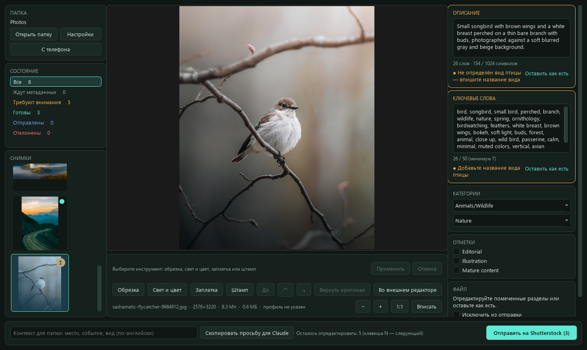

# Stock Uploader

**Русский** · [English](README.en.md) · [Deutsch](README.de.md)

Программа для Windows, которая готовит фотографии к продаже на Shutterstock: проверяет файлы, показывает описания и ключевые слова для правки, позволяет подправить снимок и загружает всё на сток.

## О программе

- **Проверка файлов.** Отсеивает снимки, которые сток не примет: меньше 4 Мп, больше 150 Мп, тяжелее 50 МБ, не JPEG.
- **Описания и ключевые слова.** Их составляет Claude Code по вашей подписке и записывает в файл рядом со снимками; программа подхватывает их сама. Платный API не нужен.
- **Пометки для ручной правки.** Разделы, где нужно ваше знание (вид животного, место съёмки, люди и логотипы в кадре), обведены оранжевой рамкой с подсказкой, что сделать.
- **Редактор.** Обрезка и выравнивание горизонта, свет и цвет, заплатка и штамп для удаления логотипов и пятен. Оригиналы не изменяются.
- **Приём снимков с телефона** по Wi-Fi через QR-код, без приложения на телефоне.
- **Отправка.** Загрузка по FTPS с возобновлением после обрыва и готовый CSV для страницы Submit.
- **Интерфейс** на русском, английском и немецком, тёмная и светлая темы.

**Идея:** M. Mashura
**Техническая реализация:** Claude (Anthropic)

## Установка

1. Скачайте архив `StockUploader-0.1.0-win64.zip` со страницы [Releases](../../releases/latest).
2. Распакуйте его в любую папку.
3. Запустите `StockUploader.exe`.

Устанавливать ничего не нужно, Python не требуется. Программа не подписана, поэтому при первом запуске
Windows может показать предупреждение SmartScreen — нажмите «Подробнее» → «Выполнить в любом случае».

Для составления описаний откройте Claude Code в распакованной папке: в ней лежит файл `CLAUDE.md`
с порядком работы.

## Краткая инструкция

1. **Откройте папку** с фотографиями (JPEG). Слишком маленькие или тяжёлые файлы попадут в «Отклонены».
2. **Снимки с телефона.** Нажмите «С телефона», наведите камеру телефона на QR-код и выберите снимки на открывшейся странице. Телефон и компьютер должны быть в одной сети Wi-Fi; при первом запуске Windows спросит разрешение на доступ к сети — разрешите. Снимки сохраняются в `Изображения\StockUploader\Phone`, в подпапку с сегодняшней датой, и программа сразу её открывает. Другую папку можно выбрать в настройках.
3. **Подправьте снимки**, если нужно: обрезка и горизонт, свет и цвет, заплатка и штамп. У каждого инструмента есть «Применить» и «Отмена».
4. **Впишите контекст** внизу слева — место, событие, название вида (по-английски). Этого по снимку узнать нельзя.
5. **Получите описания.** Нажмите «Скопировать просьбу для Claude», вставьте её в Claude Code, открытый в папке программы, и отправьте. Снимки сами перейдут в «Готовы» или «Требуют внимания».
6. **Разберите помеченные.** Раздел с оранжевой рамкой нужно поправить или нажать «Оставить как есть». Клавиша **N** — следующий помеченный снимок.
7. **Отправьте.** Кнопка «Отправить на Shutterstock» загрузит готовые снимки и создаст файл CSV.
8. **Завершите на сайте.** На странице Submit нажмите CSV, выберите созданный файл, выделите снимки и нажмите Submit.

Логин и пароль Shutterstock вводятся один раз в настройках; пароль хранится в диспетчере учётных данных Windows. Все правки сохраняются сами.

## Где что лежит

| Что | Где |
|---|---|
| Отредактированные версии снимков | подпапка `_edited` в папке со снимками |
| Копии для загрузки и CSV | подпапка `_shutterstock` |
| Описания от Claude | файл `_metadata.jsonl` |
| Снимки с телефона | `Изображения\StockUploader\Phone\ГГГГ-ММ-ДД` |
| Настройки | `%APPDATA%\StockUploader\config.json` |
| Ваши правки, журнал | `%LOCALAPPDATA%\StockUploader` |
| Список категорий и запрещённых слов | `categories.txt`, `blocklist.txt` рядом с программой |

## Ограничения

- Только JPEG; видео, вектор, RAW и HEIC не поддерживаются.
- Последний шаг — загрузка CSV и кнопка Submit — делается на сайте вручную: у Shutterstock нет способа сделать это программно.
- Описания составляются в Claude Code на компьютере; сама программа к моделям не обращается.
- ExifTool не входит в комплект. Без него описания и ключевые слова попадают на сток через CSV, чего достаточно; запись их в сами файлы включится, если положить `exiftool.exe` рядом с программой.

## Документация и условия

- [Руководство пользователя](docs/USER_GUIDE.md)
- [История изменений](CHANGELOG.md)
- [Условия использования](LICENSE.txt)

Программа бесплатна. Исходный код не публикуется.
