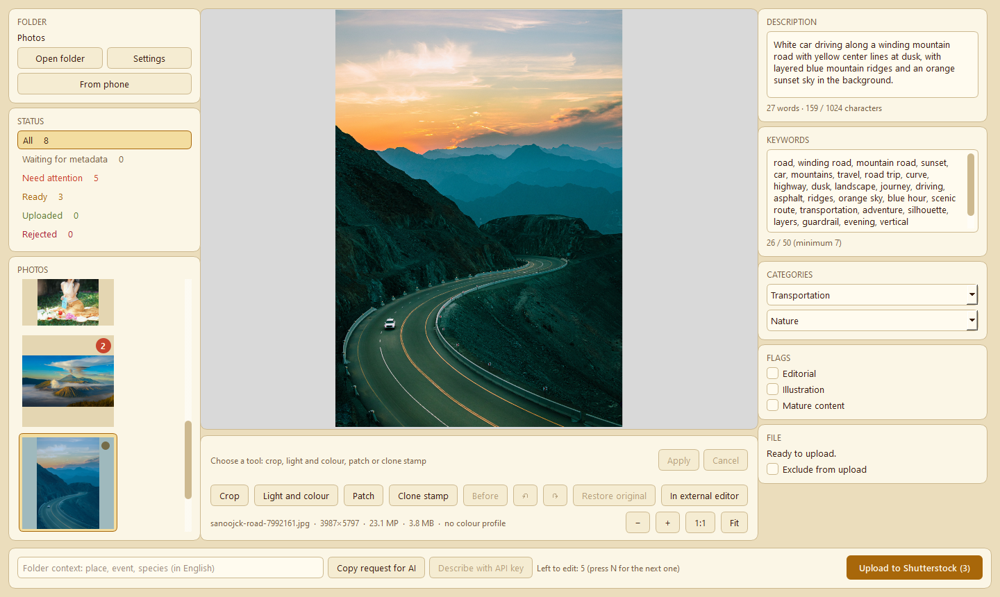

# Stock Uploader

[English](README.md) · [Deutsch](README.de.md) · **Українська**

Програма для Windows, яка готує фотографії до продажу на Shutterstock: перевіряє файли, показує описи та ключові слова для правки, дає змогу підправити знімок і завантажує все на сток.

## Про програму

- **Перевірка файлів.** Відсіює знімки, яких сток не прийме: менше 4 Мп, більше 150 Мп, важчі за 50 МБ, не JPEG.
- **Описи та ключові слова** трьома способами: однією кнопкою за ключем API (Anthropic, OpenAI або Google), через будь-якого ШІ-агента з доступом до теки (Claude Code, Codex, Gemini CLI) або вручну. Ключ API необов'язковий: через підписку на ШІ-агента платний API не потрібен.
- **Позначки для ручної правки.** Розділи, де потрібне ваше знання (вид тварини, місце зйомки, люди й логотипи в кадрі), обведені помаранчевою рамкою з підказкою, що зробити.
- **Редактор.** Обрізання й вирівнювання горизонту, світло й колір, латка та штамп для видалення логотипів і плям. Оригінали не змінюються.
- **Прийом знімків з телефона** через Wi-Fi за QR-кодом, без застосунку на телефоні.
- **Надсилання.** Завантаження за FTPS із відновленням після обриву та готовий CSV для сторінки Submit.
- **Інтерфейс** англійською, німецькою та українською, темна й світла теми.

**Ідея:** M. Mashura
**Технічна реалізація:** Claude (Anthropic)

## Встановлення

1. Завантажте архів `StockUploader-0.1.0-win64.zip` зі сторінки [Releases](../../releases/latest).
2. Розпакуйте його в будь-яку теку.
3. Запустіть `StockUploader.exe`.

Нічого встановлювати не потрібно, Python не потрібен. Програма не підписана, тому під час першого запуску
Windows може показати попередження SmartScreen — натисніть «Докладніше» → «Все одно виконати».

Описи можна отримати за ключем API прямо в програмі (налаштування → «Описи (ШІ)») або через будь-якого
ШІ-агента: кнопка «Скопіювати прохання для ШІ» кладе інструкцію в теку зі знімками.

## Коротка інструкція

1. **Відкрийте теку** з фотографіями (JPEG). Занадто малі або важкі файли потраплять у «Відхилені».
2. **Знімки з телефона.** Натисніть «З телефона», наведіть камеру телефона на QR-код і виберіть знімки на сторінці, що відкрилася. Телефон і комп'ютер мають бути в одній мережі Wi-Fi; під час першого запуску Windows запитає дозвіл на доступ до мережі — дозвольте. Знімки зберігаються в `Зображення\StockUploader\Phone`, у підтеку з сьогоднішньою датою, і програма одразу її відкриває. Іншу теку можна вибрати в налаштуваннях.
3. **Підправте знімки**, якщо потрібно: обрізання й горизонт, світло й колір, латка та штамп. Кожен інструмент має «Застосувати» і «Скасувати».
4. **Впишіть контекст** унизу ліворуч — місце, подію, назву виду (англійською). Цього за знімком дізнатися не можна.
5. **Отримайте описи.** Три способи. Кнопка «Описати за ключем API» — програма сама надсилає прев'ю обраному постачальнику (ключ вводиться в налаштуваннях, вкладка «Описи (ШІ)»; це платно, оплата йде з вашого акаунта в постачальника). Кнопка «Скопіювати прохання для ШІ» — програма кладе в теку зі знімками інструкцію, а скопійоване прохання ви вставляєте будь-якому ШІ-агенту, який бачить цю теку й уміє дивитися зображення. Або впишіть описи вручну. Знімки самі перейдуть у «Готові» або «Потребують уваги».
6. **Розберіть позначені.** Розділ із помаранчевою рамкою треба поправити або натиснути «Залишити як є». Клавіша **N** — наступний позначений знімок.
7. **Надішліть.** Кнопка «Надіслати на Shutterstock» завантажить готові знімки й створить файл CSV.
8. **Завершіть на сайті.** На сторінці Submit натисніть CSV, виберіть створений файл, виділіть знімки й натисніть Submit.

Логін і пароль Shutterstock вводяться один раз у налаштуваннях; пароль зберігається в Диспетчері облікових даних Windows. Усі правки зберігаються самі.

## Де що лежить

| Що | Де |
|---|---|
| Відредаговані версії знімків | підтека `_edited` у теці зі знімками |
| Копії для завантаження та CSV | підтека `_shutterstock` |
| Описи від ШІ | файл `_metadata.jsonl` |
| Інструкція для ШІ-агента | файл `_AI_INSTRUCTIONS.md` у теці зі знімками |
| Знімки з телефона | `Зображення\StockUploader\Phone\РРРР-ММ-ДД` |
| Налаштування | `%APPDATA%\StockUploader\config.json` |
| Ваші правки, журнал | `%LOCALAPPDATA%\StockUploader` |
| Список категорій і заборонених слів | `categories.txt`, `blocklist.txt` поруч із програмою |

## Обмеження

- Лише JPEG; відео, вектор, RAW і HEIC не підтримуються.
- Останній крок — завантаження CSV і кнопка Submit — робиться на сайті вручну: у Shutterstock немає способу зробити це програмно.
- Описи складає ШІ: за вашим ключем API (платно, у постачальника) або зовнішній ШІ-агент; сама програма нічого не вигадує. Роботу з ключами API перевірено на підставних відповідях, але не на справжніх серверах постачальників; якість описів різних моделей не порівнювалася. Роботу з конкретними ШІ-агентами не перевіряли.
- ExifTool не входить до комплекту. Без нього описи й ключові слова потрапляють на сток через CSV, чого достатньо; запис їх у самі файли ввімкнеться, якщо покласти `exiftool.exe` поруч із програмою.

## Документація та умови

- [Посібник користувача](docs/USER_GUIDE.md)
- [Безпека й особисті дані](docs/SECURITY.md)
- [Історія змін](CHANGELOG.md)
- [Ліцензія](LICENSE.txt)

## Ліцензія

Власницька, не відкритий код; вихідний код не публікується. Незмінену збірку можна безкоштовно завантажувати й
запускати, зокрема для комерційної роботи; копіювання, поширення, продаж, декомпіляція й похідні роботи
потребують письмового дозволу автора. Повний текст (англійською): [LICENSE.txt](LICENSE.txt). Контакт:
zuntuf@proton.me
