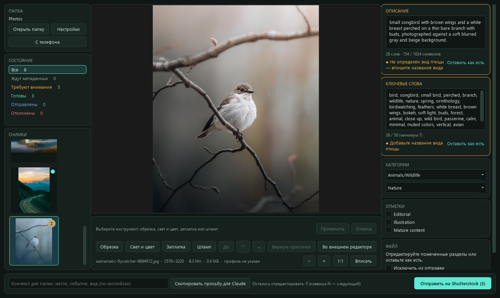

# Руководство пользователя

Краткая версия из восьми шагов есть в самой программе: «Настройки → Краткая инструкция». Здесь то же самое подробно.

## Что понадобится

- Windows 10 или 11.
- Аккаунт контрибьютора Shutterstock.
- Claude Code с подпиской — для составления описаний и ключевых слов. Без него программа работает, но описания придётся вписывать вручную.

## Окно программы

- **Слева** — папка, фильтр по состояниям и миниатюры снимков.
- **В центре** — выбранный снимок и инструменты редактора под ним.
- **Справа** — карточка снимка: описание, ключевые слова, категории, отметки.
- **Внизу** — контекст папки, кнопка просьбы для Claude и кнопка отправки.

### Состояния снимков

| Состояние | Что значит | Что делать |
|---|---|---|
| Ждут метаданных | Описания ещё нет | Попросить Claude обработать папку |
| Требуют внимания | Есть замечания | Поправить помеченные разделы |
| Готовы | Всё в порядке | Можно отправлять |
| Отправлены | Уже загружены на сток | Ничего |
| Отклонены | Файл не подходит стоку | Заменить файл; причина видна в карточке «Файл» |

Значок на миниатюре показывает состояние, а оранжевый кружок с цифрой — сколько разделов нужно поправить.

## 1. Открыть папку

Нажмите «Открыть папку» и выберите папку со снимками. Программа берёт только JPEG из самой папки, без вложенных.

Сток не примет и программа сразу отклонит:

- снимки меньше 4 мегапикселей (ширина × высота меньше 4 000 000) и больше 150 Мп;
- файлы тяжелее 50 МБ;
- не JPEG.

Если у снимка цветовой профиль не sRGB, программа предупредит: цвета на стоке могут исказиться.

## 2. Принять снимки с телефона

1. Нажмите «С телефона».
2. Наведите камеру телефона на QR-код. В браузере телефона откроется страница.
3. Нажмите «Выбрать снимки» и отметьте нужные в галерее.

Снимки сохраняются в `Изображения\StockUploader\Phone`, в подпапку с сегодняшней датой, и программа сразу её открывает. Другое место выбирается в настройках.

Если страница на телефоне не открывается:

- проверьте, что телефон и компьютер в одной сети Wi-Fi;
- при первом запуске Windows спрашивает о доступе программы к сети — нужно разрешить;
- гостевые сети Wi-Fi часто запрещают устройствам видеть друг друга.

Принимаются только JPEG до 60 МБ. Если камера телефона снимает в HEIC, переключите её на JPEG.

## 3. Подправить снимок

Инструменты находятся под снимком. Выбрали инструмент — в полосе над кнопками появились его настройки и кнопки «Применить» (Enter) и «Отмена» (Esc).

| Инструмент | Что делает |
|---|---|
| Обрезка | Рамка за углы или целиком, пропорции, выравнивание горизонта ±15°, поворот на 90° |
| Свет и цвет | Яркость, контраст, тени, насыщенность, теплее–холоднее, «Авто» |
| Заплатка | Закрасьте лишнее — область заполнится по окружению. Для логотипов, надписей, пятен |
| Штамп | Alt+щелчок задаёт, откуда копировать, затем рисуйте. Для мест, где заплатка мажет |

Полезно знать:

- **«Отмена»** убирает только то, что сделано этим инструментом с момента входа в него.
- **Ctrl+Z и Ctrl+Y** отменяют и возвращают по одному шагу.
- **«До»** — удерживайте, чтобы увидеть оригинал.
- **«Вернуть оригинал»** удаляет все правки снимка.
- **Колёсико мыши** меняет масштаб (от «снимок целиком» до 800 %), клавиша `1` — масштаб 100 %, клавиши `[` и `]` — размер кисти, пробел — двигать снимок при ретуши.
- Обрезать меньше 4 Мп нельзя: размер под снимком краснеет, такая обрезка не сохранится.
- Заплатка и штамп показывают полный кадр без обрезки и коррекции света.

Правки сохраняются сами при переходе к другому снимку. Оригинал не меняется: результат лежит в подпапке `_edited`.

Редактировать лучше до получения описаний — тогда Claude описывает итоговый кадр.

## 4. Вписать контекст

Поле внизу слева: место съёмки, событие, название вида — по-английски, например `Lisbon, Portugal, tram 28`. По снимку этого узнать нельзя, а для продаж это важно. Контекст относится ко всей папке.

## 5. Получить описания

1. Нажмите «Скопировать просьбу для Claude».
2. Откройте Claude Code в папке программы, вставьте просьбу (Ctrl+V) и отправьте.

Claude проверит файлы, посмотрит уменьшенные копии и запишет описания, ключевые слова и категории. Снимки в окне сами перейдут в «Готовы» или «Требуют внимания» — программу перезапускать не нужно.

Если лимит подписки закончился посреди папки, повторите просьбу позже: обработка продолжится с оставшихся снимков.

## 6. Разобрать помеченные

Раздел, который нужно поправить, обведён оранжевой рамкой, под полем написано, что сделать. Например: «Не определён вид обезьяны — впишите название вида».

- Поправили раздел — пометка снимается сама.
- Всё верно и так — нажмите «Оставить как есть» рядом с замечанием.
- «Принять всё как есть» в карточке «Файл» снимает все пометки снимка.
- Клавиша **N** — следующий снимок с пометками.

Нарушения лимитов (слишком короткое описание, меньше 7 ключевых слов, нет категории) снять кнопкой нельзя — их нужно исправить.

Ограничения Shutterstock:

| Поле | Требование |
|---|---|
| Описание | от 5 слов до 1024 символов, по-английски |
| Ключевые слова | от 7 до 50 уникальных |
| Категории | одна обязательна, вторая по желанию |

Отметка **Editorial** нужна для снимков с узнаваемыми людьми, логотипами или событиями, которые нельзя продавать для рекламы. Для таких снимков сток обычно требует в описании место и дату съёмки.

## 7. Отправить

Перед первой отправкой введите логин и пароль Shutterstock в настройках и нажмите «Проверить подключение FTPS».

Кнопка «Отправить на Shutterstock» внизу справа показывает число готовых снимков. После подтверждения программа:

1. делает копии в подпапке `_shutterstock`;
2. загружает их на сток;
3. создаёт файл CSV с описаниями, ключевыми словами и категориями;
4. открывает Проводник с этим файлом и сайт Shutterstock.

Если связь оборвалась, нажмите «Отправить» ещё раз — загрузка продолжится с неотправленных. Кнопка «Остановить» прерывает загрузку после текущего файла.

Снимок, который отправлять не нужно, отметьте галочкой «Исключить из отправки».

## 8. Завершить на сайте

1. Подождите, пока файлы появятся на странице Submit (до 10 минут).
2. Нажмите там кнопку CSV и выберите файл, выделенный в Проводнике.
3. Выделите все снимки и нажмите Submit.

Этот шаг делается вручную: у Shutterstock нет способа сделать его программно.

## Настройки

- **Язык** — русский, английский, немецкий. После смены программа предложит перезапуститься.
- **Тема** — тёмная или светлая, меняется сразу.
- **Папка для снимков с телефона.**
- **Логин и пароль Shutterstock.** Пароль хранится в диспетчере учётных данных Windows, а не в файлах программы.
- **Краткая инструкция** и **О программе**.

## Вопросы и ответы

**Программа изменит мои оригиналы?**
Нет. Правки, копии для загрузки и служебные файлы лежат в подпапках, имена которых начинаются с подчёркивания.

**Можно ли удалить подпапки `_previews`, `_edited`, `_shutterstock`?**
`_previews` — да, они создаются заново. `_edited` — это ваши правки снимков. `_shutterstock` — копии уже отправленного и CSV; после отправки на сайте их можно удалить.

**Я переименовал или перенёс снимок. Правки описания пропадут?**
Нет: программа узнаёт снимок по содержимому, а не по имени. Но описание от Claude привязано к имени файла — для переименованного снимка попросите обработать папку ещё раз.

**Описания получились на другом языке, чем интерфейс.**
Так и должно быть: описания и ключевые слова для Shutterstock всегда английские. На языке интерфейса пишутся только пометки «проверить вручную».

**Что такое ExifTool и нужен ли он?**
Он записывает описание и ключевые слова внутрь файла снимка. Программа работает и без него: сток получает всё из CSV. Чтобы включить запись в файлы, положите `exiftool.exe` рядом с программой.

**Антивирус ругается на программу.**
Собранный exe не подписан, для таких программ это обычное предупреждение.
